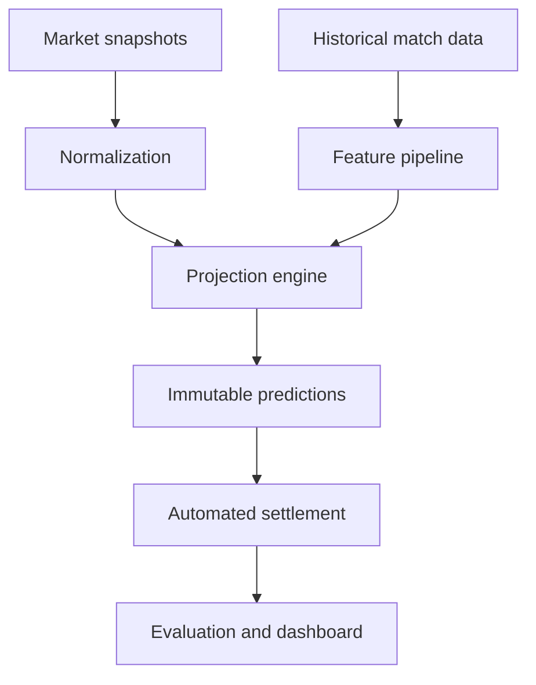

# DFS Esports Analytics — Portfolio Demo

A public, sanitized demonstration of an esports prop analytics workflow built
around Valorant player markets.

The production platform is maintained in a private repository. This companion
project demonstrates the system design, evaluation methodology, and dashboard
experience without publishing proprietary collectors, model parameters, or
historical databases.

## What this demonstrates

- A reproducible evaluation pipeline for player-prop projections
- Immutable prediction snapshots and post-match settlement concepts
- Mean absolute error, directional bias, Brier score, and hit-rate reporting
- Edge-bucket analysis that tests whether larger model disagreements perform better
- A Streamlit dashboard built from sanitized synthetic data
- Unit tests and continuous integration for the public evaluation layer

## Why the evaluation matters

The goal of the project is not to manufacture impressive backtests. It is to
test whether a model produces reliable forecasts and actionable decisions.

One development snapshot contained 346 settled predictions and 172 graded
signals. The model was nearly unbiased, but its 44.2% directional hit rate did
not demonstrate a betting edge. The larger-edge buckets also failed to
outperform consistently. That result informed the next research priorities:
better matchup context, unique-market evaluation, calibration, and stricter
separation between projection error and betting value.

## Demo dashboard

```bash
python -m venv .venv
```

Windows PowerShell:

```powershell
.\.venv\Scripts\Activate.ps1
python -m pip install -r requirements.txt
streamlit run app.py
```

macOS/Linux:

```bash
source .venv/bin/activate
python -m pip install -r requirements.txt
streamlit run app.py
```

Run the tests:

```bash
python -m pytest
```

## System architecture



The private production implementation also includes source-specific collection,
verified player identity resolution, cached map history, conservative match
settlement, exception reports, and versioned prediction storage.

## Repository contents

```text
.
├── app.py                         # Public Streamlit dashboard
├── src/
│   └── metrics.py                 # Reusable evaluation calculations
├── sample_data/
│   └── demo_predictions.csv       # Synthetic demonstration data
├── tests/
│   └── test_metrics.py            # Metric and edge-bucket tests
├── docs/
│   └── ARCHITECTURE.md            # Production-oriented design discussion
└── .github/workflows/tests.yml    # CI test workflow
```

## Public/private boundary

This repository intentionally excludes:

- Live sportsbook or fantasy-platform collectors
- Credentials, endpoints requiring private access, and operational configuration
- Proprietary projection formulas and tuned parameters
- Player-history databases and real market snapshots
- Full automated-settlement matching logic
- Subscription, authentication, and payment infrastructure

The included dataset is synthetic and is provided only to exercise the public
dashboard and evaluation code.

## Technology

Python · pandas · Streamlit · pytest · GitHub Actions

## Responsible use

This project is an analytics and software-engineering demonstration. It does
not provide betting recommendations or guarantee profitability. Any future
commercial version would require validated pricing inputs, independent testing,
monitoring, jurisdiction-aware controls, and clear responsible-gaming safeguards.

## Copyright

Copyright © 2026 Christopher Wong. All rights reserved. See [NOTICE.md](NOTICE.md).
